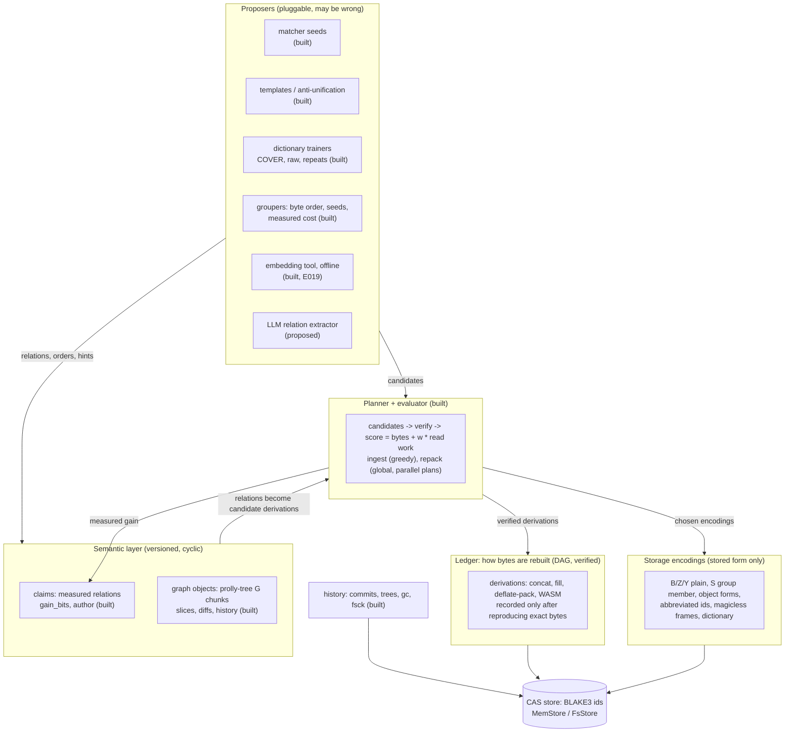
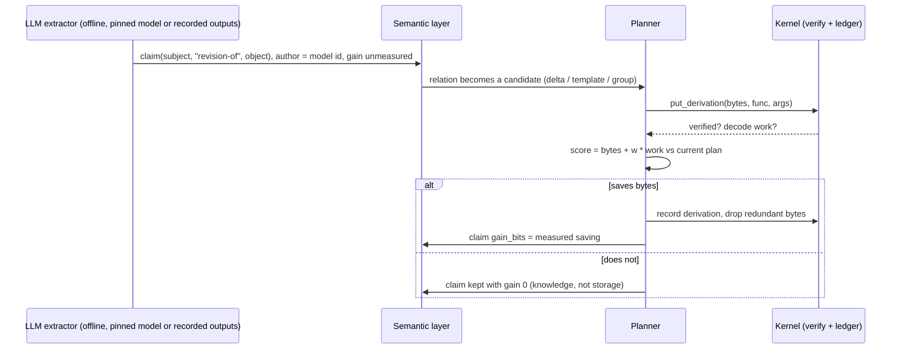
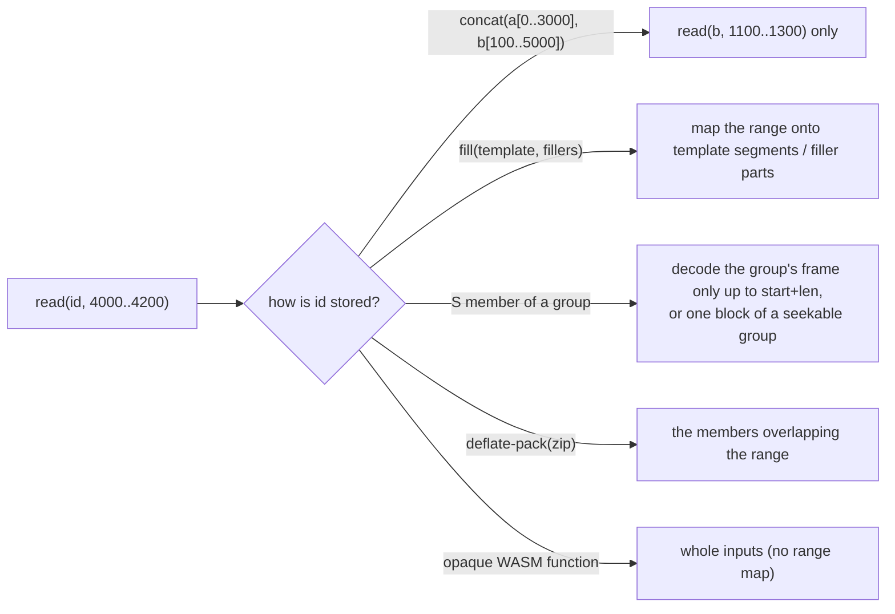

# IKAM system architecture (proposed)

Status: proposal. Parts marked **built** exist on `feature/rust-kernel` (experiments E000–E020); parts marked **proposed** do not. Claims about effects are measured only where an experiment is cited.

## The idea in one paragraph

Every file is stored as verified, content-addressed bytes. **How** its bytes are stored (whole, sliced, templated, grouped, derived by a function) is a replaceable plan, chosen by measured size and read cost. The **meaning** of content (relations, entities, versions, render structure) is a separate, versioned graph layer. Semantic proposers, including LLMs, write into that layer. The planner turns the layer's relations into candidate derivations, and only what is verified byte-exactly and measured to pay is kept. Meaning can therefore guide storage but never corrupt it.

## North star (the user's stated goal, 2026-10-20)

Take in data from arbitrary sources (files or streams) and organize it automatically into **one graph** that:
- reproduces every original byte-exactly;
- compresses highly efficiently **across** sources. Information shared between elements, including elements of different file types (the same facts in a markdown note, a docx, a pdf and a spreadsheet), is stored once.

What this means for the benchmark: per-type corpora (md, pdf and office stored separately) cannot show cross-type sharing. The measurement has to ingest mixed sources into one store and compare it with the sum of the separate stores and with the baseline (E077 onward).

## Layers



| layer | role | guarantee |
|---|---|---|
| CAS store | bytes by id | ids are BLAKE3; every read is checked against its id |
| Encodings | the smallest stored form of the same bytes | changing an encoding never changes an id |
| Ledger | `output = func(args)`, a DAG | recorded only if it rebuilds the exact bytes; cycles rejected |
| Planner and evaluator | chooses among verified candidates | score = bytes written + `read_weight` x decode work |
| Semantic layer | claims (measured, mutable) and graphs (versioned snapshots) | never on the rebuild path, so cycles are safe |
| Proposers | suggest relations, orders, candidates | may be wrong or nondeterministic; nothing they produce is trusted unverified |
| History | commits, trees, gc, fsck | gc keeps what live data needs: derivation inputs, dictionaries, groups, graph targets |

## LLM relations into compression (proposed)

An LLM is good at naming *why* two pieces of content are related. Byte matching cannot see that. Each relation type maps to the compression mechanism worth trying:

| relation (free-text predicate) | candidate the planner tries | mechanism |
|---|---|---|
| revision-of, copy-of, derived-from | delta: slices of the base, or `fill` with the base as template | ledger derivation (built) |
| same-form-as (invoice, report, slide) | induce one template over the set | templates (built) |
| same-topic-as, same-project-as | put in one group; train a family dictionary | groups (built), per-family dictionary (proposed) |
| contains, embeds, rendered-from | unpack the container; derive the rendering | `deflate-pack`, WASM functions (built) |
| translation-of, summary-of | none expected to pay | kept as knowledge only |



Rules that keep this sound:
- **Reproducibility.** Model calls never run inside the benchmark or the kernel. An extractor writes its relations once (claims, or a proposal file as in E019) with the model id and revision recorded. Re-running the planner on the same relations gives the same store.
- **No trust in model output.** A wrong relation costs a failed verification or a rejected plan, never wrong bytes.
- **Learning from measurements.** Measured `gain_bits` per relation type is the training signal for which relations to propose. This is DeepSketch's lesson: learn from measured compression, not from semantic similarity. E019 measured embeddings as informative but dominated by measured cost.

## Reconstruction functions as a library in the graph (proposed, from the user's direction)

The LLM's main job is to **write reconstruction functions**, not only to name relations. Functions are stored like everything else, organised in the graph, and applied through the ledger. Reconstruction can then be any algorithm: arithmetic (a multiplication table), common algorithms (run-length, delta, transpose, reversal), templates, experimental ones, or recursive and fractal generators.

**What exists (built).** A derivation's function may be any WASM module stored as content (`func.rs`, `wasm.rs`, `tests/exec.rs`):
- deterministic: no imports, floats disabled, bounded fuel and memory;
- verified: recorded only after reproducing the exact bytes;
- used by repack: it drops stored bytes a function rebuilds when that is cheaper.

So an LLM-written function can never produce wrong bytes; at worst it fails verification or does not pay.

```mermaid
flowchart LR
  subgraph Lib["Function library (graph G: one node per function)"]
    F1["rle-decode"] ---|composes| F2["delta-decode"]
    F3["dsl-interpreter"] ---|runs| P1["program: 'table i*j'"]
    F4["transpose"]
  end
  LLM["LLM (offline): sees content + library + past failures"] -->|new function or small program| Lib
  Lib -->|candidate: output = f(args)| V{"verify: exact bytes?<br/>fuel and memory bounded"}
  V -->|yes| S{"pays? module counted once,<br/>amortised over every use,<br/>+ w * fuel"}
  V -->|no| X["discard; record the failure for the LLM"]
  S -->|yes| R["ledger derivation; stored bytes dropped;<br/>claim: measured gain per function"]
  S -->|no| K["keep as library entry only if reused elsewhere"]
```

Design points:
- **Library in the graph.** Each function is a graph node targeting its module (content). Edges record "applied-to" (its derivations), "composes" and "generalises". Claims carry the measured gain per function, which is the evidence for keeping it, generalising it, or dropping it (library learning, as in Stitch and babble).
- **Cost is description length.** A module is content, so it is stored once and shared by every derivation that uses it; its bytes are paid once. Each use pays only its small argument contents and its fuel (read work). This is the minimum-description-length rule DreamCoder, Stitch and Brevis use, and the kernel's evaluator already counts it this way.
- **Small programs over a shared interpreter.** An LLM-written WASM module is hundreds of bytes or more. A better shape is one stored interpreter module for a small deterministic language (integer arithmetic, loops, byte output, calls to library functions). Each LLM program is then a short argument, tens of bytes, so a program that generates a 100 KB table can cost less than its zstd output. *[inference]*
- **Composition and recursion.** Function outputs are content, so functions feed functions: delta of a transpose, a template filled by a generator, a fractal as an iterated function. The ledger's DAG is the composition; cycles stay impossible, as reconstruction requires.
- **Determinism limits.** No floating point: fractals and numeric generators use fixed-point integers or a deterministic soft-float compiled into the module.
- **Where it should pay (from the literature, not yet measured here).** Data that is the output of a procedure: computed spreadsheet columns, numeric sequences, logs, procedural images, generated code. For prose, the KoLMogorov Test (ICLR 2025) found frontier LLM programs failing 40–78% of the time and losing to gzip when correct. Templates, deltas and the dictionary remain the right tools there.
- **Reproducibility.** The LLM runs offline. Its functions and programs are stored as content, so once written they are ordinary data. The benchmark never calls a model.

## Partial reads: decompress only the segments needed (partly built, E028)

**Yes, the render structure lets reads decode only what they need, with one codec-level limit.**

A file's render pipeline is already explicit in the ledger: `concat` of byte ranges, `fill(template, fillers)`, `deflate-pack(manifest, members)`, groups. Graph nodes can name semantic segments as `Arg::Range` targets ("slide 3", "section 2"). A range read can therefore walk the pipeline backwards:



- **concat and slices** (built, E028): exact. A range of the output is a computable set of ranges of the inputs (`Repo::read_range`, `src/range.rs`).
- **fill** (built, E028): exact. Template segments and filler parts have known offsets. The template and fillers are still decoded whole; only the output is partial.
- **Containers** (proposed): a range of a zip maps to the members that cover it, plus header bytes. Today a range read rebuilds the whole container and slices it.
- **Opaque WASM functions** (whole read, then sliced): no general range map, so whole inputs are needed, unless the function declares one (a proposed extension).
- **The codec limit.** A zstd frame decodes sequentially. Inside a group, reading a member must decode from the frame start to the member's end: on average half the group, not all of it (built, E028: whole reads now decode 0.50–0.68x of what full-group decoding did on the group-heavy corpora). To read one segment in O(segment), a group is split into **independently decodable blocks** (zstd's "seekable format": frames of a few KiB plus an offset table, shipped in zstd's `contrib/`). Blocks lose some shared context, and the dictionary recovers part of it. The block size is then a measured trade-off.

With range reads, the evaluator can price **decode work actually needed** for a given access pattern (whole files, or segments named in the graph), instead of today's proxy (bytes produced by derivations, decompression unpriced).

## Model state as content (far-out, not planned; C9 in `docs/research/latent-reasoning.md`)

Inference servers already address prompt and KV caches by prefix. The kernel could store them too, as content and derivations. The catch is the exactness law: a KV cache is reproducible only for one (model weights, inference code, hardware, numeric precision) tuple. BF16 and FP16 runs on the same prompts diverge in 49–100% of cases (`docs/research/kernel-direction.md`).

So any such derivation would have to name that tuple in its function id, and fsck could only re-verify it on matching hardware. Until the kernel has a reason to hold model state, this stays a note.

Three things would make it concrete:
- a deterministic inference function that the kernel can run (CPU, fixed precision);
- a workload of repeated prompt prefixes;
- a measurement of prefix dedup against storing the caches whole.

## What exists and what is next

| step | status | measure |
|---|---|---|
| CAS, ledger, verify-before-record, history, gc, fsck | built | all laws and tests (55) |
| encodings, dictionary, groups, abbreviated ids | built | score 0.8896 -> 0.4762 (E000–E020, two benchmark changes) |
| graphs: prolly chunks, cycles, slices, diffs | built | laws 1–7; repo-graph corpus |
| proposer hook (orders) and offline embedding tool | built | E019 (neutral) |
| read benchmark: per-read decode work for whole-file and segment reads | proposed, next | new reported metric, not scored at first |
| range reads through concat, fill, containers and groups (stop the frame early) | proposed | decode work per read, same stored bytes |
| seekable groups (independent blocks) | proposed | bytes vs decode work per read, block size swept |
| evaluator prices decompression | proposed | score and read metric together |
| generated corpus (computed tables, sequences, logs, procedural images) | built (E021) | new reference 0.5225 |
| deterministic integer interpreter (WASM) + programs as arguments; WASM fuel priced as decode work | built (E022); programs hand-written | generated 175,169 -> 12,851 B |
| programs compiled to their own WASM modules (the interpreter costs ~1,300 wasmi fuel per op) | built (E023) | generated -> 6,241 B; Mandelbrot 440x less decode work |
| function library as a graph under `meta/functions` (functions, applications, measured savings and work) | built (E024) | capability; bytes reported |
| LLM function writer and relation extractor (offline, outputs recorded) | proposed (needs an API key or a local model) | bytes saved per function and relation (measured `gain_bits`) |
| per-family dictionaries from relations | proposed | office/md bytes |
| `quote` derivation: line-numbered, JSON-escaped slices of stored content | built (E056; repack now plans a fact's inputs first) | transcripts 113,507 -> 71,507 B |
| related-content zstd context (`Q` encoding: another stored content as the frame's context, one step) | built (E057) | score 0.2929 -> 0.2920; structured -6.5 K |
| content search with an optional trigram index (exact: candidates are decoded and checked) | built (E058), reported, not scored | pays above 19-65 searches per read pass on generated, repo-history, office, md |
| planner prices plans by the measured read term; repack accepts by the whole store and is a fixed point after one call | built (E059, E060) | score 0.2920 -> 0.2903 |
| smaller search index | dropping common trigrams refuted (E061, on its branch); next: compress postings (bitmaps, key dictionary) | index bytes vs decode per query |
| verification chosen per encoding: raw bytes with a CRC-32 ("W"), one hash per compressed read | built (E074, E075); zstd frame checksums tried and discarded while hot content is raw (E076) | score 0.97 -> 0.61 |
| cross-source measurement: one graph against per-type stores (`examples/cross.rs`), and the `multiformat` corpus scored as one graph | built (E077, E081) | north star: one graph should be smaller than the per-type stores |
| deflate streams inside any file expanded (zlib streams, PDF FlateDecode, at memLevel 8 or 9) | built (E080, E083) | multiformat one graph 894,449 -> 382,635 B (0.34x the baseline) |
| two complementary contexts ("M": a content shaped like it plus its words in another format) | built (E084); joint choice of context hubs vs groups open (E085 refuted) | cases one graph -2.1%, multiformat -1.3% |
| several dictionaries for mixed stores | refuted as tried (E078 larger, E079 two clusters) | one graph still uses one dictionary |
| repack cost: one dictionary re-planned (E087), codecs skipped when their decode cost alone loses (E088) | built | score 0.58 -> 0.43; repack CPU -60% to -90% |
| search over shared structure: chunk index (each distinct chunk and seam once, E089), trigram postings per chunk (E094); scans priced in planning | built | score 0.43 -> 0.26; structured search 1.5 -> 0.3 ms, transcripts 0.8 -> 0.4 ms |
| plans the read weight rules out are not searched for (slices, templates, induced re-plans, E092; fewer re-plans, E090) | built | identical output; ingest CPU -70% to -98% |
| graph chunks priced by their reads (E093) | built | repo-graph 0.80 -> 0.40 |
| groups dissolved for context encodings (E091) | refuted for bytes (groups already capture it) | weight 0: -0.13% |
